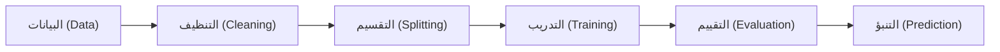

# 🎓 التنبؤ بمؤشر الأداء الأكاديمي للطلاب (Student Performance Prediction)

---

## 📌 ملخص المشروع (Project Summary)
يمثل هذا المستودع المشروع النهائي لدورة **"الذكاء الاصطناعي وتعلم الآلة"** للمرحلة الثانوية، حيث تم بناء نموذج تعلم آلة (Machine Learning Model) باستخدام خوارزمية الغابة العشوائية (`RandomForestRegressor`) عبر بيئة Google Colab. يهدف المشروع إلى التنبؤ بمؤشر الأداء الدراسي للطلاب (`Performance Index`) بدقة عالية اعتماداً على مجموعة من العوامل الدراسية والأنشطة اليومية.

---

## 🎯 المشكلة والهدف (Problem & Goal)
* **ماذا يتوقع النموذج؟** يتوقع النموذج قيمة رقمية تمثل مؤشر الأداء الأكاديمي للطالب (`Performance Index`) بناءً على درجاته السابقة، ساعات دراسته، ساعات نومه، عدد الاختبارات التجريبية التي تدرب عليها، ومشاركته في الأنشطة اللاصفية.
* **لماذا هذا مفيد؟** يساعد المعلمين والطلاب على فهم العوامل الأكثر تأثيراً في التحصيل الدراسي، وتقديم تدخلات وتوجيهات تعليمية مبكرة لتحسين مستوى الطلاب قبل الاختبارات النهائية.
* **نوع المهمة (Task Type):** تنبؤ بقيمة رقمية مستمرة (Regression).

---

## 📊 جدول البيانات (Dataset Overview)

| العنصر (Element) | التفاصيل (Details) |
| :--- | :--- |
| **المصدر (Source)** | منصة Kaggle — ملف `archive.zip` |
| **حجم البيانات (Dataset Shape)** | 10,000 صف × 6 أعمدة |
| **عمود الهدف (Target Variable)** | `Performance Index` |
| **نوع المهمة (Task Type)** | تنبؤ بقيمة رقمية (Regression) |

---

## 🔄 مخطط سير العمل (Workflow Diagram)

---

## ⚙️ خطوات العمل (Workflow Steps)

1. **تحميل واستكشاف البيانات (Data Loading & Exploration):** قراءة ملف البيانات `archive.zip` باستخدام مكتبة `pandas` والتأكد من أبعاده (10,000 صف × 6 أعمدة) وخلوّه من أي أعمدة غير ضرورية (الأعمدة المحذوفة: لا يوجد).
2. **تنظيف وتجهيز البيانات (Data Cleaning & Preprocessing):** التحقق من عدم وجود قيم مفقودة (أعمدة عولجت قيمها الناقصة: لا يوجد)، وتحويل العمود النصي `Extracurricular Activities` إلى صيغة رقمية باستخدام الترميز الأحادي (`One-Hot Encoding`) لتصبح الخصائص الجاهزة 5 خصائص.
3. **تقسيم البيانات (Data Splitting):** تقسيم مجموعة البيانات بنسبة 80% للتدريب (8,000 صف) و20% للاختبار (2,000 صف) لضمان تقييم عادل للنموذج.
4. **تدريب النموذج (Model Training):** بناء وتدريب نموذج الغابة العشوائية (`RandomForestRegressor`) من مكتبة `scikit-learn` على بيانات التدريب.
5. **تقييم الأداء (Model Evaluation):** قياس دقة النموذج على بيانات التدريب والاختبار باستخدام مقياسي `MAE` و $R^2$ ومقارنته بمرجع التخمين (`Baseline`).
6. **استخراج الأهمية والتنبؤ (Feature Importance & Prediction):** تحليل أهم 5 خصائص مؤثرة في التنبؤ بمؤشر الأداء (`Performance Index`) واستخدام النموذج للتنبؤ بالقيم الجديدة.

---

## 📈 جدول النتائج (Model Evaluation Results)

| المقياس (Metric) | القيمة (Value) | المعنى والمقارنة (Meaning & Baseline Comparison) |
| :--- | :---: | :--- |
| **مرجع التخمين (Baseline MAE)** | `16.21` | متوسط الخطأ المطلق لو خُمّن المتوسط الحسابي فقط دون تعلم آلة. |
| **متوسط الخطأ المطلق (Test MAE)** | **`1.81`** | متوسط الفارق بين القيمة المتوقعة والحقيقية؛ يمثل انخفاضاً ضخماً في الخطأ مقارنةً بـ `16.21`. |
| **معامل التحديد على التدريب (Train $R^2$)** | `0.997` | يوضح قدرة النموذج العالية جداً على تفسير التباين في بيانات التدريب. |
| **معامل التحديد على الاختبار (Test $R^2$)** | **`0.986`** | أداء متقارب جداً مع التدريب، مما يؤكد أن النموذج **فهم الأنماط** ويجيد التعميم دون فرط في التخصيص (`Overfitting`). |

---

## 🌟 جدول أهم 5 خصائص (Top 5 Important Features)

| الترتيب | اسم الخاصية (Feature Name) | التفسير المنطقي لتأثيرها (Logical Interpretation) |
| :---: | :--- | :--- |
| **1** | `Previous Scores` | الدرجات السابقة تعكس المستوى التراكمي للطالب واستعداده الأكاديمي الأساسي. |
| **2** | `Hours Studied` | زيادة ساعات الدراسة المنتظمة ترتبط مباشرةً باستيعاب أعمق للمادة ورفع الأداء. |
| **3** | `Sleep Hours` | الحصول على ساعات نوم كافية يعزز التركيز والذاكرة والاستيعاب أثناء المذاكرة والاختبار. |
| **4** | `Sample Question Papers Practiced` | التدرب على نماذج الاختبارات يكسر رهبة الامتحان ويُحسّن مهارات إدارة الوقت وحل الأسئلة. |
| **5** | `Extracurricular Activities_Yes` | المشاركة في الأنشطة اللاصفية تنمي مهارات التنظيم والانضباط وتنعكس إيجاباً على التوازن الدراسي. |

---

## 🚀 طريقة التشغيل (How to Run)

1. اضغط على شارة **Open In Colab** في أعلى هذا الملف لفتح دفتر الملاحظات `Project_ML_Kaggle.ipynb` مباشرةً في Google Colab.
2. قم بتحميل ملف البيانات `archive.zip` من رابط Kaggle الموضح أدناه (أو من ملفات هذا المستودع).
3. في واجهة Google Colab، افتح قائمة الملفات الجانبية (**Files**) واضغط على أيقونة الرفع (**Upload**) لرفع ملف `archive.zip` إلى بيئة العمل.
4. شغّل جميع الخلايا بالترتيب من القائمة العلوية عبر اختيار **Runtime > Run all** لمشاهدة مراحل المعالجة، الرسوم البيانية، ونتائج التقييم.

---

## 💡 ماذا تعلمت؟ وأفكار للتحسين مستقبلاً (Lessons Learned & Future Work)

### ماذا تعلمت؟
* أهمية مقارنة نتائج النموذج بمرجع بسيط (`Baseline`) لإثبات القيمة الحقيقية التي أضافها تعلم الآلة (خفض الخطأ من `16.21` إلى `1.81`).
* كيفية تحويل البيانات النصية الفئوية إلى أرقام عبر تقنية `One-Hot Encoding` لتصبح صالحة لتدريب النماذج.
* الفرق بين الحفظ (`Overfitting`) والفهم (`Generalization`) من خلال مقارنة أداء التدريب (`0.997`) بأداء الاختبار (`0.986`).

### أفكار للتحسين مستقبلاً
* تجربة خوارزميات انحدار أخرى مثل الانحدار الخطي المتعدد (`LinearRegression`) أو `GradientBoostingRegressor` ومقارنة دقتها مع الغابة العشوائية.
* ضبط المعاملات الفائقة (`Hyperparameter Tuning`) لنموذج `RandomForestRegressor` لمحاولة تقليل قيمة `MAE` إلى أقل من `1.81`.
* بناء واجهة تفاعلية بسيطة (مثل تطبيق `Streamlit` أو `Gradio`) تتيح للطلاب إدخال بياناتهم وتوقع مؤشر أدائهم فوراً.

---

## 🔗 مصدر البيانات (Data Source)
* **مجموعة البيانات على Kaggle:** [Student Performance (Multiple Linear Regression)](https://www.kaggle.com/datasets/nikhil7280/student-performance-multiple-linear-regression)

---

تمت صياغة هذا الملف بمساعدة أداة ذكاء اصطناعي، وراجعت محتواه وتأكدت من صحة أرقامه.
